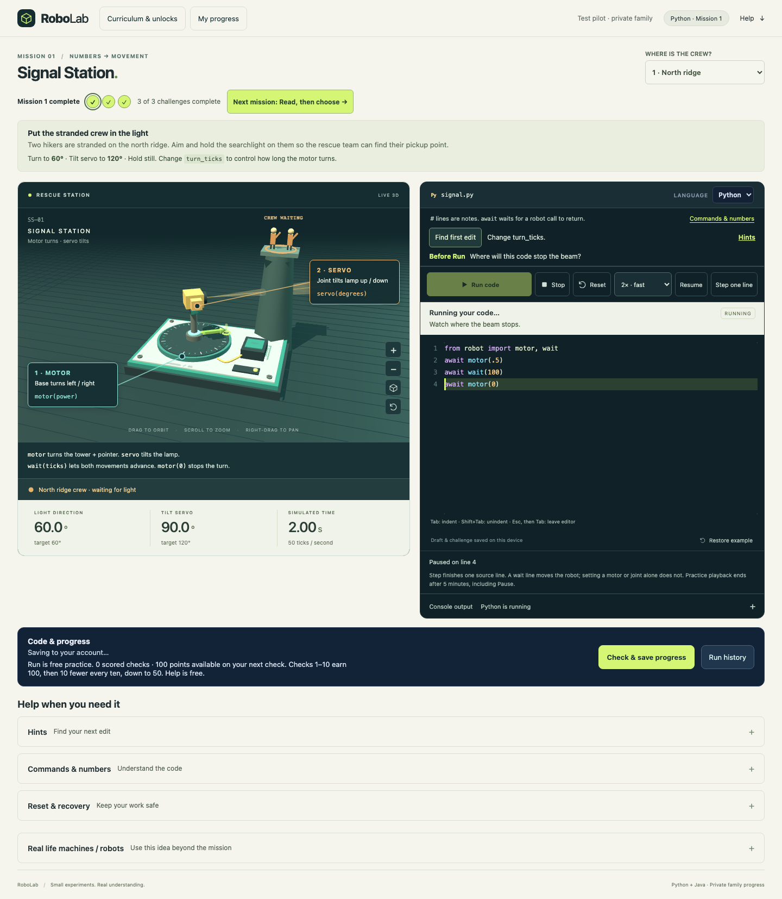
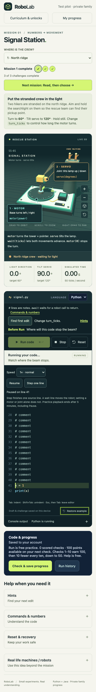

# TRACE-01 verification

Review candidate on `codex/execution-tracing`, base `763c5ac`, ownership `1181109`. Exact tested implementation commit is recorded in PROGRESS.md after validation. This opening local receipt preceded the separately authorized hosted release; current release evidence follows and is recorded in PROGRESS.md.

## Hosted release, October 27, 2026

- Hosted release: [PR #17](https://github.com/willcheung/3d-robotics-hack/pull/17) merged and is live on [RoboLab](https://robolab.vibecodingdad.com) after explicit owner authorization. Exact tested source `4cfd37f117caef6192922d18ef5ed75e481630fb`; squash merge `204b09982ad58881b1987577435fcac12ea8194a` has the identical tree. Exact-head [acceptance CI](https://github.com/willcheung/3d-robotics-hack/actions/runs/40468048819/job/122068129784) and publication checks passed. All 281 local-suite cases passed together: 54 unit, 74 family/API, 24 family UI, 22 isolated Java and 107 workshop browser cases. An initial CI attempt hit its 35-minute scheduling ceiling with all earlier groups and 90 browser cases passed; 45 minutes allowed the complete suite without changing assertions or individual execution limits. The interrupted 17 cases also passed a separate local check. A later CI run passed 280 cases and exposed a slow-frame fixture that included setup-line reading in its motion window. The test now pauses at the wait boundary before applying render stress; its eight-second completion bound and numerical assertions are unchanged, and three focused repeats passed before the final complete run.
- Real hosted qualification passed on protected staging and the public app: eight lesson/language playback cases, two actual carrying-lift arm cases, two 25-second Pause cases, twelve family/security cases, full both-language progression through all twelve checked challenges, and release smoke/clean console checks. Actual loop visits and untaken branches, measured 0.5×/2× motion, normal-speed model invariance, Pause/Step synchronization, errors/Stop/retry, preserved drafts, sibling separation and fresh-browser resume were exercised. Synthetic desktop/narrow screenshots were inspected. Twelve staging Sandbox/Blob provider checks independently covered JDI execution, isolation, deadlines and normal VM cleanup.
- A protected production candidate passed real Java parcel streaming, all twelve Python authoritative checks, forged-result rejection and native JDI loop/branch/helper-return streaming before promotion. Uploaded artifacts and served assets match clean Node 24 packages. The Python runtime was promoted first; the previous live app executed real Python successfully with the new legacy-compatible handshake before app promotion. Both public aliases and the existing scheduled configuration point to the accepted app. Credentials, stores, limits and account settings were preserved; shared quotas were never reset. Private operational receipts retain deployment IDs, package hashes, cleanup and rollback artifacts.

Live browser checks use Chromium and disposable synthetic profiles. Parent-session fixtures do not establish email delivery or actual learner observation. The additional arm check pauses during the carried parcel’s lift wait, confirms frozen displayed joint/parcel state, then steps to the next command at 2.90 simulated seconds with elbow 70° and holding 1. The extended Pause check waits 25 real seconds, then steps and finishes in each runtime.

## Local evidence

- Native Python monitoring/stack switching and JDI line breakpoints/method returns drive the same playback gate. The robot model is unchanged; fixed ticks and sensor replies remain outside student execution.
- Eight mission/language references run at 2× and 0.5×, reach their targets and retain identical simulation time. Existing mission journeys exercise all twelve variations, wrong programs, errors, Stop/Reset and language/draft recovery.
- Real loop/branch fixtures step through both loop iterations in actual order and skip untaken bodies. Helpers restore the caller before a robot argument takes effect. The helper-return mismatch was reproduced independently in both real runtimes before repair.
- Pause in a moving wait freezes simulation time; Step completes only the remaining wait and stops before the following motor call. Speed changes, draft edits/restoration, Stop and rerun are exercised. A separately reproduced delayed-command race now gates setters and sensor replies too.
- An expensive-render regression reproduced 1,216 ms for 400 ms of model playback when render time accumulated per tick. The repaired presentation clock completes the same fixed ticks in about 476 ms while retaining Pause/Step behavior. A separate 80 ms render fixture reproduced input starvation in catch-up batches; the repaired clock yields browser tasks, and scheduled Pause/Stop now interrupt before completion; browser references and patrols are rechecked after this repair.
- Parser/runner tests reject invalid source positions, sequence IDs and overlapping/stale events without model changes. Work budgets exclude teaching waits but retain cumulative runtime work. Native unresponsive calls exercise the 20-second watchdog; the five-minute practice cap includes Pause.
- Unsupported-stack-switching fault injection runs real Python without tracing, releases a pre-load Pause and resets slow speed to 1×. This is fault-injected Chromium evidence, not a Safari/Firefox device pilot.
- Standard account checks retain immutable source, private family separation, canonical scoring/unlocks, cancellation, saved-work conflicts and atomic service caps. Longer practice leases do not free a still-running practice slot; score-check leases remain unchanged.
- All four local package configurations validate routing, streaming flags, origin/CSP boundaries, immutable debugger assets and license notices. No provider credentials or paid runs are used.

Final command counts/results and remaining gates are recorded in PROGRESS.md. A passing mock account projection is not evidence of scored progression; the disposable family suite runs the actual isolated check adapters.

## Inspected synthetic visuals and informed teaching review

Inspected 1440-pixel Python/Java and 390-pixel narrow captures. The current row is visible behind readable syntax colors, source line numbers align after auto-scroll, controls fit without horizontal overflow and keyboard focus can leave the native editor. Highlight painting does not change selection or source.

The designer/critic/model lenses retained purpose-first lessons and setters-versus-motion semantics. An informed student/teacher walkthrough (the reviewer already knew implementation/reference programs) checked Run → Pause → Step → inspect robot → edit → Stop/retry and returning to saved contexts. The visible explanation distinguishes source-line stepping from stepping an expression and says wait advances motion. This supplies a way to trace L01 movement, L02 branch choice, L03 repeated checkpoint holds and L04 coordinated joints without exposing new solutions. It does not establish teen comprehension or class pacing.

## Remaining qualification

- Unknown/late Sandbox.create resolution and failed cleanup remain provider-uncertainty boundaries. The gateway startup timer is not a proof of provider creation latency; lease arithmetic alone cannot establish cleanup.
- Hosted native JDI launch inside bubblewrap/private loopback, protected Function streaming/replies, measured speed, Pause/Step/Stop and normal cleanup passed on the released package. Exceptional provider creation/cleanup uncertainty remains distinct from these successful lifecycle checks.
- Synchronous JavaScript-to-Python callbacks preserve their original behavior with an explicit console notice; their internal lines cannot pause. The real SOP/CSP browser fixture reproduces and verifies this recovery. Released lessons do not use this advanced interop.
- Real non-Chromium/device acceptance. Python line controls require browser stack switching; ordinary Run is retained when unavailable. Java trace support is independent of that browser feature.
- Java multi-threaded programs: released lessons are single-threaded; JDI suspends all debuggee threads at source boundaries. No concurrent-language-debugger claim is made.
- A real learner explaining the relation between a highlighted wait, a powered motor, branch selection and loop repetition. Completion alone is not evidence of understanding.
