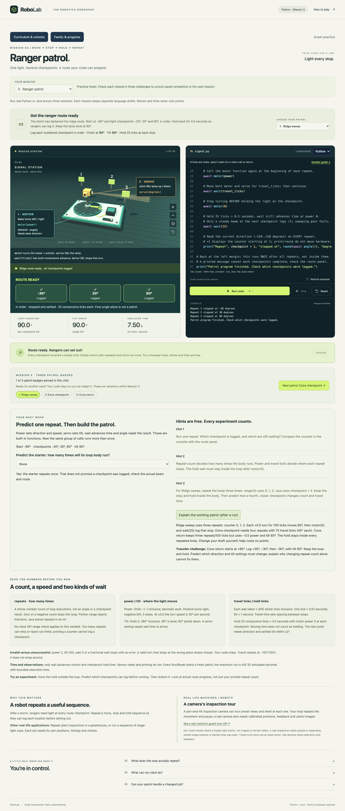
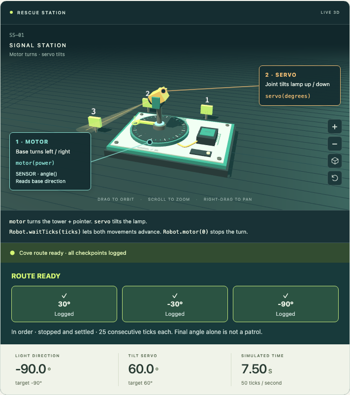
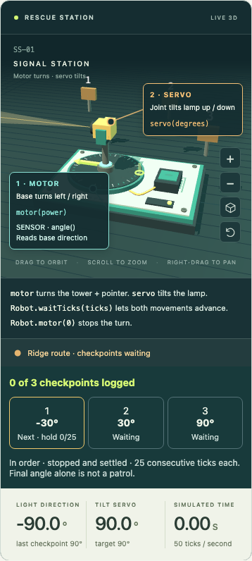

# Mission 3 readiness and owner QA

Mission 3, **Ranger patrol**, adds a complete loop lesson with three patrols in Python and Java. After a storm, the learner uses the existing pan/tilt light to illuminate each ranger checkpoint in order. A checkpoint logs only after the light is stopped and settled there for 25 consecutive ticks (0.5 seconds). The final angle alone cannot complete the job.

## Teaching and curriculum decisions

The working starter inspects one checkpoint. The first experiment changes a repeat count; later patrols change spacing, direction and tilt. The lesson explains each variable, valid API ranges, ticks, `await`, loop syntax and fresh sensor readings, with blank lines between comment/code groups. Predictions, three free hints, an optional worked explanation and three patrol badges follow the existing lesson framework. The real-machine connection is a pan/tilt inspection camera visiting preset views; illumination does not prove terrain safety or image recognition.

The course still has 16 core and four optional lessons. L04 introduces the arm's shoulder, elbow and third powered gripper. L05 introduces learner-written, parameterized handoff functions called inside loops. A later roller intake or flywheel/feed-gate foam launcher is a proposal requiring a separate physical/safety contract, sensors, reference/wrong programs and learner feedback. It is not implemented or an extra promised core lesson. Missions 1–2 keep their existing physics, data keys and progress.

## Acceptance evidence

- Model/schema/preview tests cover ordered/consecutive dwell, exact boundaries, skipped/duplicate points, drive-through, wrong tilt, no stop, too few/excess repeats, determinism, reset and prior behavior.
- Real Pyodide and isolated Java browser journeys execute the starter and all three patrols, hints/predictions, intentional mistakes, syntax/range errors, infinite-loop Stop, Reset during execution and a successful retry. Expected reference times are 7.50, 8.00 and 7.50 simulated seconds.
- Family/account checks cover all six independent drafts, old experiment restore, fresh-device saved work, sibling isolation and pending-check navigation in L02/L03. Real local Java checks unlock L02, then L03 and save all nine milestones. The server selects the scenario and canonical model/version; fabricated client outcomes, poses and checkpoint counts cannot grant completion.
- The full acceptance suite preserves Missions 1–2, editor behavior, account/recovery/onboarding and runtime isolation. Clean source exports install successfully and build both verified Vercel packages without deployment.
- Desktop, narrow and downhill-route images are inspected below. The draft PR's final receipt identifies the exact tested commit and CI runs; those checks must match its head before acceptance.

## Owner walkthrough (about 20 minutes)

1. Open Mission 3. Identify the motor, tilt servo, checkpoint order and why the field team needs a steady light. Confirm the route goal is understandable before reading code.
2. In Python, predict and run the unchanged starter. One checkpoint should log and the job should remain unfinished. Open hints only as needed, then adapt the loop to finish Ridge sweep.
3. Try Extra checkpoint and Cove return. Confirm the earlier program can miss the changed job; adjust the relevant settings. Check the console, highlighted checkpoints and final success agree.
4. Repeat in Java. Explain what the loop counter and its increment do, which lines repeat, and why a hold outside the loop is different. Help should not cost points.
5. Try too few/excess repeats and an invalid power. Stop a run, Reset, then run valid code. Source must survive and stopped/failed work must not grant a badge.
6. Switch languages and missions, reload, inspect the curriculum and restore a draft. All six drafts must stay separate. Revisit Missions 1–2 and check they still feel familiar. Mission 4 remains planned.
7. At the separately authorized staging release check, use disposable family accounts: verify prior missions, check all three L03 patrols in both languages, save drafts, sign in on another browser and confirm progress/drafts. Check a sibling remains locked. Do not use production student work as test fixtures.

## Remaining limits and release gates

This is a local, review-ready lesson, not a deployed release. Local family tests use disposable in-memory storage and real Java; browser Python uses real Pyodide. They do not establish L03 Vercel Sandbox/Blob behavior. Both-language hosted checked progress and protected staging/candidate acceptance remain mandatory before a separately authorized deployment. No production records, secrets, automation or account settings change in this slice.

Badges record successful simulated jobs, not understanding or official competition scores. A manually repeated correct sequence may pass; ask the learner to explain and predict the loop separately. One-hour pacing, teen engagement, accessibility with actual assistive technology and target-device performance still require human observation. The existing broader understanding/local-journal work remains a separate slice. No claim of hardware calibration, image sensing or physical robot safety is made.
