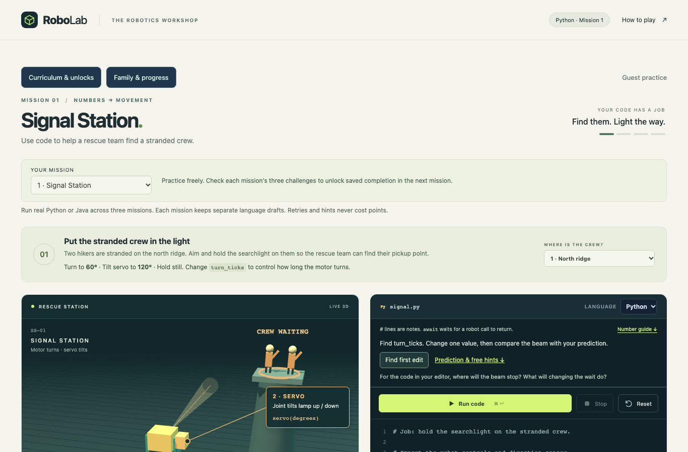
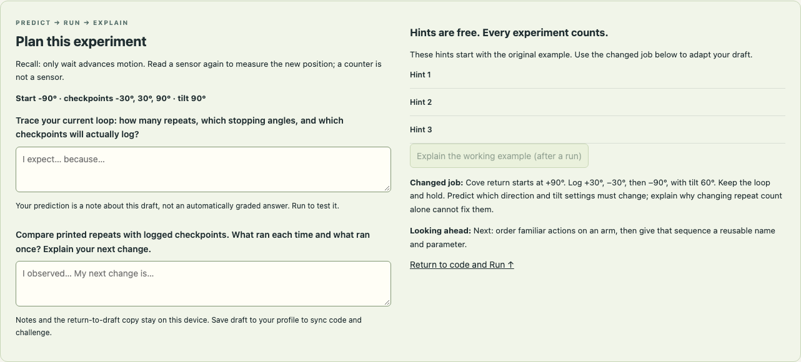

# A progressive robotics course

October 13, 2026. This design applies the curriculum designer, critic and teacher review lenses to the whole course. The owner authorized teaching improvements across Missions 1–3 and future plans. This is one refinement slice on `codex/mission-03-patrol`, based on `f5e0e5a90725fce2e7b4812d024e22b222b99b9e`. L01–L02 are released; L03 and these refinements remain review candidates until landed and released. Future rows are authored requirements, not implemented lessons or permission to start them.

## Refinements implemented in the review candidate

1. Make feedback truthful about the failed requirement. A completed patrol can still finish at the wrong angle. A printed loop counter does not prove a checkpoint was held. Diagnose these separately from errors.
2. Preserve the experiment, including its selected challenge. A cove program reopened against the ridge silently changes the problem. Keep separate mission/language/profile drafts, a recoverable example restore, and explicit local-versus-profile save wording.
3. Ask about the current program. Desired movement and actual code can disagree: the Mission 2 starter turns away from the crew. Use an ungraded prediction, a real run and a learner explanation; do not guess arbitrary program behavior by parsing source text.
4. Make the same routine reachable in all three missions. Provide a first-edit shortcut, Run above the long commented code, free graduated hints, and a connection to what comes next. Keep the numerical explanations and real-language execution.
5. Gate future content on progression and pilot evidence. Add a new mechanism or idea only after retrieving what the learner needs. A green run is completion evidence; transfer and explanation are separate.

Evidence: the previous teaching review reproduced misleading patrol feedback, lost case context, original-starter prediction mismatch and destructive example restore in a disposable local browser. Source inspection confirmed M1's authored hints were not rendered in the shared coach. The implementation adds targeted regressions for those paths. Difficulty, motivation and teacher intervention remain learner hypotheses; no classroom pilot is claimed.

## Next curriculum decisions

October 13 review of `73c52e063d5894d68e52901ce4340538cb9c0303`, using curriculum designer, critic, teacher and retrospective lenses. This pass inspects source and existing evidence; it is not a new browser walkthrough or student pilot. The new repository skill instructions do not change the app. [PROGRESS.md](PROGRESS.md) remains the release ledger and [TASKS.md](TASKS.md) remains the build queue.

The priority is to validate the revised foundation sequence before expanding the course. Preserve its real-language execution, useful jobs, free help, recoverable experiments and separation of completion from understanding. The remaining uncertainty is how learners use these supports, not whether more lesson outlines can be written.

| Finding / priority | Evidence and consequence | Next action, owner and status | Success criterion and next check |
| --- | --- | --- | --- |
| NEXT-01 · Current candidate first | L03 and the shared L01–L03 improvements are in draft PR #4; L01/L02 are live. The recorded software checks do not establish hosted acceptance of the new code. See [Mission 3 QA](MISSION-03-QA.md). | Maintainer: walkthrough of the current candidate, then separately authorized protected staging/release qualification. Pending; no release is authorized by this plan. | Both languages and all three missions pass the existing owner checklist; staging checks establish saved code/challenge, checked prerequisites and sibling isolation on the exact release candidate. |
| NEXT-02 · Observe cumulative understanding | `src/teaching.ts` asks about the current draft; `src/lessons.ts` separates the branch comparison from movement; `docs/MISSION-03.md` explicitly allows a physical success without proving loop understanding. No actual learner evidence is recorded. The intended L01 → L02 → L03 progression remains a hypothesis. | Teacher/maintainer: run the observation protocol below on the revised candidate in an appropriate local or authorized staging environment. Pending real observations. This can accompany owner QA; publication is not a prerequisite. | Record per learner whether they can predict, edit, recover, explain a changed case and resume. Use those observations to select a focused correction or retain the sequence; do not turn badges into a mastery claim. |
| NEXT-03 · Prepare the arm transition | [L04/L05 progression](#progression-and-transfer-map) separates arm sequence from function definition, but [S04](TASKS.md#s04--one-arm-mission) has no frozen mission/model contract. Its old S03-only dependency did not reflect the chosen L03-before-L04 delivery order. | Curriculum/model authors: next mission-design task is L04 Parcel Port after the foundation review. S04 stays draft; its dependency now includes landed S08. | A reviewed MISSION-04 contract supplies the decisions below and feasible independent fixtures. Only then can S04 be selected for an authorized implementation; do not start L05, rover or optional packs alongside it. |

### Observation protocol for Missions 1–3

Use each learner's chosen language; inspect both language groups when available without making a beginner learn both at once. Follow the sequence across sessions as needed. Do not compress three proposed one-hour lessons into one test. Include a genuine returning-session check when feasible; a same-day pause tests resume behavior but not week-to-week retention.

Before starting, record the tested source/version, environment, language, device/browser and whether this is a new or returning learner. Keep identifying observations and source snapshots in the maintainer's private location. Public summaries contain only anonymized findings. Record active learning time and runtime/inbox waiting separately. There is no measured pacing target yet.

| Stage | Prompt or activity | Evidence to record |
| --- | --- | --- |
| L01: values and movement | Ask what the light does for the crew. Predict the current draft, make one first edit, then try the lower cove. Ask how changing power would affect the wait needed for the same turn. | Independent first edit, prediction with a reason, observed motion, distinction between turn and tilt, changed-case explanation. |
| L02: measure and choose | Retrieve L01's power/time relationship. Trace the current condition from the 30° and 90° starts. Test the same corrected code from both sides, then explain the comparison value versus the crew's destination. | Which branch was predicted, how Read / Decision / Now were used, whether the stored reading was mistaken for a live sensor, and reasoning beyond copying the hint. |
| L03: repeat a sequence | Retrieve stop/wait and fresh-read behavior. Trace one loop body, try Extra checkpoint, and explain why a printed repeat or a final angle alone is insufficient. | Which lines repeat, where stop/hold belong, actual versus predicted checkpoints, and explanation of a changed spacing or direction. |
| Recovery and return | Let the learner recover from a natural miss/error; offer one reversible mistake if none occurs. Use ordinary hints. Save a changed case, switch/reopen, and ask them to identify the experiment and next edit. | Error versus miss, help level, adult intervention, source/challenge restored together, and ability to resume. Check profile saves separately from device-only notes. |

For each observation record: lesson/case, prediction and reason, edit, result, highest help level, adult intervention, explanation, recovery/resume outcome and unresolved question. Use met / partial / not yet observed with a short reason; asking for help is not failure. Avoid invented quotes, averaged mastery scores or claims about the class from a single learner.

Decision rule: a reproducible software/data-loss fault becomes a focused fix with a regression. If an essential explanation remains unsupported, revise the smallest teaching step and observe it again before relying on that concept in L04. A green run with a copied solution is completion only. If the learner can explain the changed case and resume, retain the scaffold and carry that evidence into the arm design. Small pilots guide revision; they do not establish a population-wide learning effect.

### Next mission-design brief: L04 Parcel Port

Keep the useful job: pick up a parcel, clear a marked obstruction, and place it in a worker's tray. Its main new demand is coordinating shoulder, elbow and an independently powered gripper using familiar sequential calls. Retrieve L01's setter-versus-arrival distinction and L03's order/stop/wait reasoning. Defer function definition and parameters to L05; do not introduce inverse kinematics or an opaque complete-the-job helper.

Before implementation, freeze joint axes and degree limits, rates and simultaneous motion, gripper aperture and timing, payload-presence semantics, reachable pickup/tray poses, grasp/contact/collision/release rules, reset behavior and exact success tolerances. Prove reference and wrong-pose/empty-grasp/early-release/collision cases with independent expected observations within the existing runtime limits. Define a first editable decision, current-code prediction, three free hints and a changed reachable tray in both languages. Include one plan for observing the first new mechanism before expanding it. These are required design outputs, not numerical decisions or completed tests.

Keep S03H as a separate potential improvement: durable explanation/history work should answer an observed need and preserve the current local/profile distinction. It is not a prerequisite for this observation pass. Official rankings, live AI, intake/flywheel proposals and optional flight/image packs do not advance the immediate foundation-to-arm decision.

## The routine that carries across lessons

Start with a useful job and a brief retrieval question. Point to the first editable decision in both languages. Before running, predict what the **current draft** will do from the **selected start**. Run real code; compare the prediction with robot state, sensor readings and the appropriate milestone trace. Change one thing, test a changed need, then explain the causal link and save a next step. Predictions are optional notes, never a success gate or a penalty.

Keep free hints in three levels: where to look, the causal relationship, then an explicit worked step. Name which example a worked hint explains; keep transfer questions visible without silently solving them. Offer worked explanations after an attempt. Retain inline comments; fade task scaffolding, not API units, safety limits, recovery or access to help. Java's boilerplate and Python's `await` must not become unexplained barriers.

The current local notes and return copy belong to a mission/language/profile on that device. A saved profile draft synchronizes source and challenge together. Notes and the return copy are not cloud learning records. Legacy source-only saves open a valid default challenge; the learner checks the visible context. Neither notes nor local diagnostics grant checked completion.

## Progression and transfer map

Each row names one main new demand. Retrieval happens before the guided edit; transfer follows a first successful experiment. The teaching order and prerequisites remain those in CURRICULUM.md and the map. Slice readiness remains in TASKS.md.

| Lesson / job | Retrieve first | Main new demand | Predict and observe | Changed need / evidence of understanding |
| --- | --- | --- | --- | --- |
| L01 · Signal Station | No coding prerequisite. Point out base turn versus lamp tilt; signed direction, degrees and whole ticks are taught here. | Commands and named values. | Predict final direction for the displayed power and wait; compare turn and tilt readouts. First edit: `turn_ticks` in either language. | East lookout changes duration; lower cove changes direction and tilt. Explain why higher power needs less time for the same turn. |
| L02 · Recover the light | From L01: power and time determine distance; setting a value is not arrival. | A sensor reading and one `if/else`. | Trace the actual condition, true/false branch, then Read / Decision / Now. First edit: comparison. | Use unchanged code at 30° and 90°; adapt comparison value and tilt for the cove. Explain why the stored reading does not update itself and why the comparison value is not a destination command. |
| L03 · Ranger patrol | From L01–02: stop versus wait; a fresh sensor read versus a stored value. | A counted loop around understood calls. | Trace one body, counter range, actual stops and steady holds; distinguish lines inside/outside the loop. | Add a closer-spaced checkpoint, then reverse/downhill travel. Explain why extra repeats can log every checkpoint but still fail the final stop, and why printed repeats can log none. |
| L04 · Parcel Port | From L03: order matters within a repeated sequence; setters need time. | Coordinate a new arm/gripper mechanism using familiar sequential calls. No new function syntax yet. | Show shoulder, elbow and gripper separately. Predict which part moves and when grasp/release can succeed; observe pose, contact and parcel state. | Move the receiving tray within a declared reachable set. Adapt the sequence and explain why closing away from the parcel or opening early fails. Do not add throwing or launch physics. |
| L05 · A reusable handoff | Reproduce one L04 handoff and identify the actions that stay together. | Define a function with one destination parameter; reuse the already-taught counted loop. | Trace the argument into the helper and distinguish defining from calling it. Keep its body visible and editable. | Call the same helper for two taught destinations inside the loop. Explain which value changes per call and why editing a copy is unnecessary. No opaque complete-the-job helper. |
| L06 · Adapt and debug | Values, branches, loops and parameters from L01–05. | Choose a diagnostic experiment; no new API. | Predict one plausible cause, change one factor, compare expected and actual state. | Repair a changed pickup or light task, then an unseen authored variant. Explain evidence that rules out another cause; passing the old example alone is insufficient. |
| R01 · Deliver to the dock | From L01/L06: signed power, duration, zero stops. | Two-wheel coordination on a new rover. | Isolate equal forward, equal reverse, unequal and opposite wheel powers before a delivery; observe body direction separately from camera orbit. | Change approach side or distance within the simple model. Explain which wheel changes an arc and which command stops both wheels. Teach meters and body heading explicitly. |
| R01b · Turn by measurement | From L02: condition and fresh reading; from L03: repeated body; from R01: wheel signs. | Bounded feedback that rechecks a condition, including `while` syntax before use. | Hand-trace read → compare → drive → wait → re-read; show each update and a maximum-iteration stop. | Change start/target heading, including the declared wrap boundary. Explain stale-reading failure. Teach signed angular error before asking the learner to solve a wrap case. |
| R02 · Stop where the person is | R01b's bounded sensing cycle and R01's stopped wheels. | Distance and clearance from a visible forward sensor. | Predict whether a reading means near, far or beyond sensor range; observe the ray and body clearance. | Move the barrier so yesterday's timing fails. Explain the condition that stops safely and why missing re-read, wait or motor stop fails. Collision is distinct from distance tolerance. |
| R03 · Delivery round | L05 helpers and R02 movement/sensing; trace one complete delivery. | A list/array and iteration over route data. | Trace index/item/order and the editable helper each item calls; observe delivered stations. | Reorder or add a stop without copying the program. Explain a skipped/duplicate item. Provide equivalent Python list and Java array objectives. |
| R04 · Misleading reading | R02 units, range, boundaries and safe stop. | Validate a sensor before using its value. | Explicitly introduce valid/unavailable states; predict what happens at the boundary and on loss. | Repair one authored unit/validity bug. Explain why unavailable is not clear path; test controlled stop separately from successful delivery. |
| C01 · Relief station | L05 handoff and R04 safe docking, each demonstrated separately. | Coordinate two familiar subsystems with explicit handoff conditions. | Trace docked/stopped → arm ready → unload; observe both controllers and parcel state. | Change one docking or tray condition. Explain why the arm waits. Use existing variables, conditions and functions; teach any phase representation before requiring it. |
| P01 · Inspection strip | R02 sensor-based stop and R04 validity. | Calibrate a brightness threshold using measured samples. | Show sensor location and units; compare dark/bright samples before choosing a threshold. | Change lighting or strip contrast. Explain overlapping readings and recalibration; no hidden auto-threshold or label-returning sensor. |
| P02 · Supply label | P01 calibration, conditions and R03 data collections. | Classify measured RGB values, including unknown. | Predict a rule from supplied samples and inspect actual channel readings. Teach the channel scale and invalid-versus-unknown distinction. | Classify changed samples, including an ambiguous one. Explain which rule wins or why none should; a color name returned as an answer cannot demonstrate classification. |
| C02 · Sort supplies | C01 docking/handoff and P02 classification. | Compose learned actions around classification. | Trace a sample through decision, selected destination and visible parcel movement. | Introduce an unknown label or move a taught bin. Explain and demonstrate safe handling; do not introduce new perception or motion mechanics. |
| C03 · Follow and dock | P01 light, R02 distance, P02 color and C01 phases. | Choose priorities among familiar sensor conditions. | Predict which condition wins when stop and follow cues occur together; observe the selected action. | Conflict two cues or lose one reading. Explain why stopping takes priority. Make arbitration visible; no untaught general navigation algorithm. |
| V01 · Inspection area (optional) | P02 RGB and R03 lists/arrays. | A small camera image as rows/columns of pixels. | Teach indexing and mount orientation using a tiny labeled grid; observe how robot motion changes the image, independently of viewer orbit. | Move the marker to a different grid region or remove it. Explain which pixels support detection. No learned vision model or answer-bearing camera API. |
| V02 · Dock under a marker (optional) | V01 location in an image, C03 priorities and R02 distance. | Combine image offset and distance in a bounded steering rule. | Trace offset → turn correction → new image, with distance-based stop. | Change marker offset or lose the marker. Explain search/stop behavior and why old detection cannot guide indefinitely. |
| F01 · Instrument landing (optional) | R04 valid readings and bounded conditions; signed values from earlier missions. | Thrust changes velocity, unlike the ideal rover motor. | Teach height, vertical speed and thrust separately. Predict motion after thrust is removed; observe falling even at zero thrust. | Change a declared starting height/speed. Explain safe touchdown versus merely reaching the pad. No mandatory equations or proportional control before instruction. |
| F02 · Launch, measure, return (optional) | F01 ascent/descent/landing and C01 explicit handoff conditions. | Compose mission phases using already-taught control. | Trace takeoff → measurement window → descent → landing and the reading that advances each phase. | Change one sampling height or return condition. Explain how phase order and touchdown criteria are preserved; no orbital or multiaxis flight. |

## Scaffold fading and readiness

L01 points to a named value. L02 asks the learner to trace a condition before editing it. L03 asks for a repeated sequence trace. L04 changes hardware while retaining syntax; L05 names the already-understood sequence. L06 removes the named bug and asks for a diagnostic choice. Rover lessons retrieve this foundation before introducing new units, geometry or feedback. Combined jobs add coordination, not several unexplained APIs at once. Optional perception and flight each begin by teaching the representation or physics that differs from earlier models.

Before marking any future lesson ready, its mission contract must include: beneficiary; one new idea; exact prerequisite retrieval; both-language first edit; a current-code prediction; independent good/wrong traces; failed-condition diagnostics; three hints and an opt-in explanation; a changed-need assessment; local/profile save and recovery; and an observation plan. Keep official score, checked completion and demonstrated understanding distinct. Verify a copied successful program can fail the changed case for a meaningful reason.

Do not multiply rover, sensor, image or flight variants before observing the first lesson in that family. At each pilot, use synthetic/anonymized records and separate infrastructure waiting from learning time. Record: first independent edit; prediction with a reason; help used; error recovery; changed-case explanation; and whether the learner resumes the correct experiment. Do not infer these from click counts or green badges.

## First classroom check

Test Missions 1–3 as a sequence with a returning-session break, in both language groups as available. The proposed one-hour pace is a hypothesis, not a pass requirement. A practical criterion for each learner is one independent edit, an explanation connecting an instruction to observed movement, recovery from one miss/error, and a changed-case explanation without copying the worked answer. Record unmet criteria individually; do not report aggregate learning claims from this software review.

Use the repository personas through the routing in [AGENTS.md](../AGENTS.md#reusable-robolab-personas): `$robolab-design` on this progression before adding a lesson, `$robolab-critique` on the actual lesson/feedback, `$robolab-student` on learner-visible content, and `$robolab-teacher` on start/recovery/resume. Use `$robolab-model` for a new mechanism, `$robolab-build` for an authorized ready slice, `$robolab-qa` for observed behavior, and `$robolab-retro` to reconcile findings with classroom evidence. A persona is a review lens, not evidence that a student or teacher actually tried the class.

## Informed release walkthrough, October 13

The owner selected a persona walkthrough now and a classroom pilot later. This pass used the skeptical-student, teacher and QA lenses on application source `33b51399b38598b376dc722032f54dfccc762039`. The reviewer had already read implementation and reference programs, so this is an **informed scripted walkthrough**, not an independent beginner attempt. Protected browser execution and screenshots support interface/software claims; none establish comprehension or class pacing. Final hosted outcomes belong to PROGRESS.md and PR #4.

| Sequence | Visible task, action and observed feedback | Teaching implication |
| --- | --- | --- |
| Mission 1 | Find first edit selects `turn_ticks`; the unchanged starter misses. A longer wait reaches the ridge, then timing/direction/tilt adapt the farther and cove cases. | Preserve the turn-versus-tilt distinction and predict-before-edit prompt. In class, ask why faster power needs less time for the same angle. |
| Mission 2 | Find first edit selects the condition. The reversed comparison misses; the corrected program works from both sides. The cove requires adapting the comparison and tilt. | Ask for the actual branch and movement, not just a changed comparison number. A comparison value does not command a stopping position. |
| Mission 3 | One repeat leaves the patrol unfinished. Count, spacing, direction and tilt distinguish the three routes; a printed counter cannot award a checkpoint. | Retrieve Mission 1's stop/wait behavior and Mission 2's fresh measurement. Ask which lines repeat and why the hold belongs inside the loop. |
| Help and return | First-edit and hint controls are reachable. Worked explanation is opt-in after a run. The hosted checks cover code/challenge save pairs and local notes separately. | Keep help free and keep the local-versus-profile distinction explicit. A real returning learner should identify the saved case and next change without reconstructing the experiment. |

Priorities after software qualification:

1. **Observe explanation and transfer before removing scaffolding.** The key unanswered question is whether learners can explain the changed case after using a hint. Observe one causal explanation and one changed case per mission; copied success alone does not satisfy the criterion.
2. **Observe reading and navigation burden, especially in Java.** The first-edit shortcut helps locate the decision, but the long commented program and lower-page explanation still need an actual learner check. Record help and active reading separately from runtime waiting; do not shorten necessary units or syntax explanations on an assumption.
3. **Prepare L04 with familiar syntax and a new mechanism.** After the release, freeze the Parcel Port arm/gripper contract and independent good/wrong traces. Keep learner-defined functions and parameters in L05. Real pilot feedback remains an input to that design; its absence must remain visible.

No demonstrated teaching defect in this informed pass calls for another sequence rewrite before release. The accepted release improvement is durable hosted coverage of the whole progression and saved context. Preserve the current scaffolding while collecting the missing human evidence.

## Implemented interface evidence

Inspected synthetic guest captures at 1366×900 and 390×844. Run and the hint link sit above the commented program; Find first edit focuses the mission's editable value or condition. These captures establish layout, not learner usability or measured learning.

Individual Java editors: [Mission 1](images/teaching-l01-editor.png), [Mission 2](images/teaching-l02-editor.png), [Mission 3](images/teaching-l03-editor.png). Narrow views: [editor](images/teaching-editor-narrow.png), [coach](images/teaching-coach-narrow.png).
